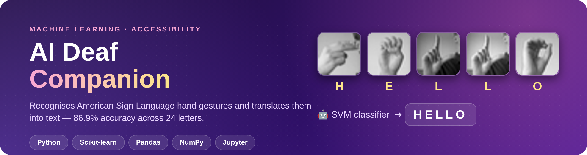
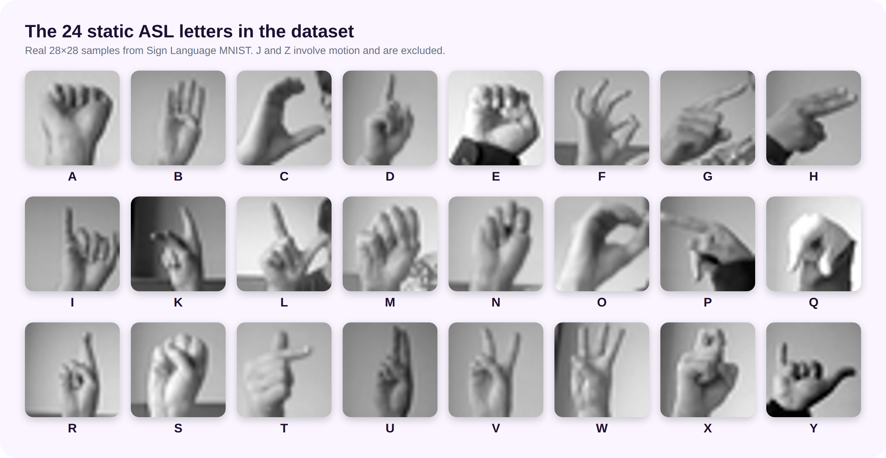
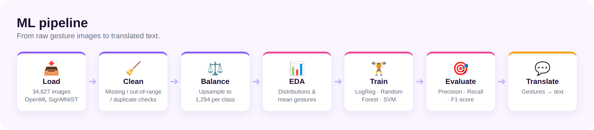
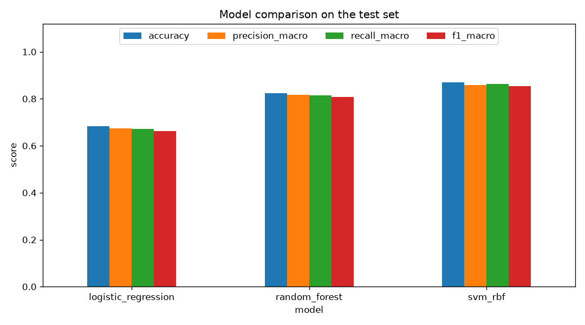
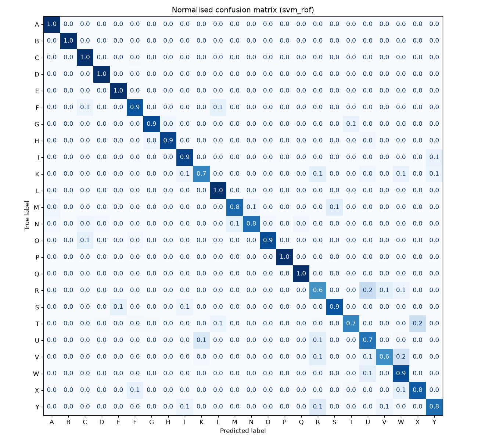
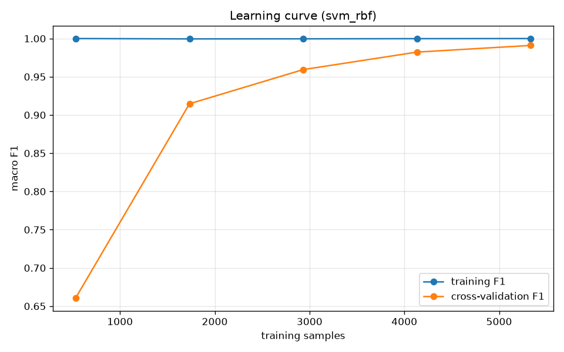
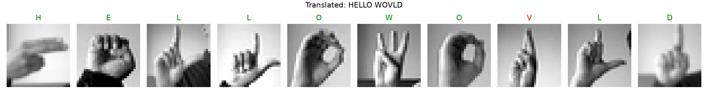

<p align="center">
  
</p>

<p align="center">
  
  
  
  
  
</p>

<p align="center">
  <b>A machine learning system that recognises American Sign Language (ASL) hand gestures and translates them into text,<br>helping deaf and hard-of-hearing users communicate with people who don't know sign language.</b>
</p>

---

## 📈 Results at a glance

<table align="center">
  <tr>
    <td align="center"><h2>86.9%</h2>test accuracy</td>
    <td align="center"><h2>0.855</h2>macro F1-score</td>
    <td align="center"><h2>24</h2>ASL letters</td>
    <td align="center"><h2>34,627</h2>gesture images</td>
    <td align="center"><h2>3</h2>models compared</td>
  </tr>
</table>

## ✨ Highlights

| | |
|---|---|
| 🧹 **Data cleaning** | Automated checks for missing pixels (median-imputed), out-of-range intensities and duplicate rows. |
| ⚖️ **Class balancing** | Training classes ranged from 957 to 1,294 images; every class is upsampled so the model isn't biased toward common letters. |
| 📊 **Exploratory analysis** | Jupyter notebook with class distributions, sample and *average* gestures per letter, and pixel statistics. |
| 🏋️ **Model comparison** | Logistic Regression, Random Forest and SVM (RBF) trained and compared on a held-out test set. |
| 🎯 **Rigorous evaluation** | Precision, recall and F1 per letter, a confusion matrix, a learning curve and a timestamped metrics log. |
| 💬 **Sign → text** | `src/translate.py` turns a sequence of gesture images into a written word. |

## 🖐️ The dataset

<p align="center">
  
</p>

[Sign Language MNIST](https://www.openml.org/d/45082), downloaded automatically from OpenML: 27,455 training and 7,172 test images, each 28×28 grayscale.

## 🔬 Pipeline

<p align="center">
  
</p>

## 🏆 Model performance

| Model | Accuracy | Precision | Recall | F1-score |
|-------|---------:|----------:|-------:|---------:|
| Logistic Regression (PCA 100) | 0.684 | 0.674 | 0.672 | 0.662 |
| Random Forest (200 trees) | 0.824 | 0.817 | 0.815 | 0.808 |
| 🥇 **SVM RBF (PCA 60)** | **0.869** | **0.858** | **0.862** | **0.855** |

<p align="center">
  
</p>

<table>
  <tr>
    <td width="55%"></td>
    <td width="45%">
      <b>What the confusion matrix shows</b><br><br>
      ✅ Letters such as <b>B, E, P, Q</b> are recognised almost perfectly.<br><br>
      ⚠️ Visually similar hand shapes, <b>R / U / V / W</b> and <b>M / N</b>, are the most common confusions; R is the weakest letter (F1 0.48).<br><br>
      📉 Cross-validation F1 on the training split reaches ~0.99 (see learning curve) because the training set contains augmented variants of the same source photos. The separate <b>test set is the honest measure</b> of real-world performance.
    </td>
  </tr>
</table>

<p align="center">
  
</p>

## 💬 Translation demo

```bash
$ python -m src.translate HELLO WORLD
Signed : HELLO WORLD
Text   : HELLO WOVLD
```

<p align="center">
  
</p>

> Green = correct, red = misclassified. The *R → V* mistake is shown on purpose: it matches the weakest class in the evaluation above.

## 🚀 Quick start

```bash
python -m venv .venv && source .venv/bin/activate
pip install -r requirements.txt

python -m src.train                 # downloads data, trains & compares models, writes reports/ and models/
python -m src.translate HELLO       # translate sample gestures for a word into text
jupyter notebook notebooks/eda.ipynb
```

## 📁 Project structure

```
ai-deaf-companion/
├── src/
│   ├── data.py          # loading, cleaning, balancing
│   ├── train.py         # training, evaluation, charts, metric logs
│   └── translate.py     # gesture sequence → text
├── notebooks/eda.ipynb  # exploratory data analysis + results
├── reports/             # charts, classification report, metrics.csv, metrics_log.jsonl
└── assets/              # README images
```

## 🗺️ Roadmap

- [ ] Real-time recognition from a webcam using hand landmarks (e.g. MediaPipe)
- [ ] Motion letters (J, Z) and whole-word signs with sequence models
- [ ] Text-to-speech so translated text can be spoken aloud
- [ ] Data augmentation with more signers to close the train/test gap
